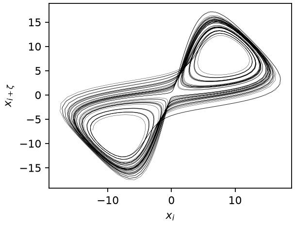
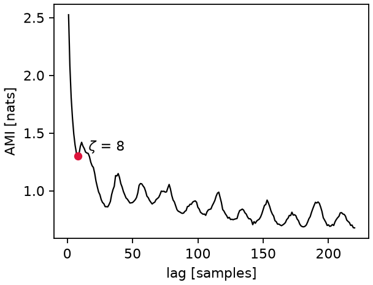
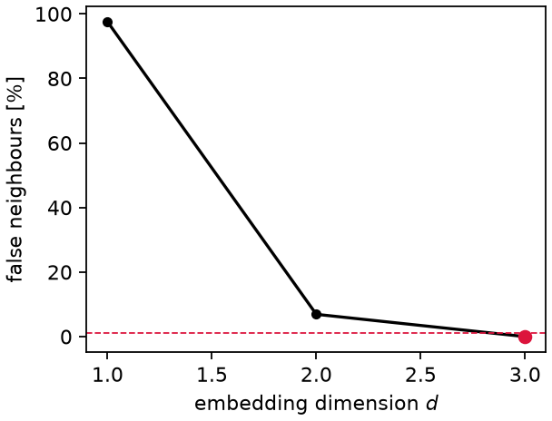
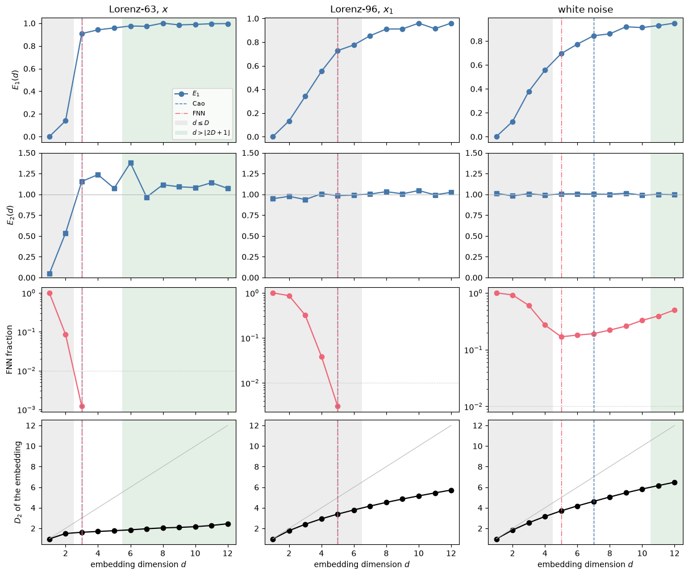
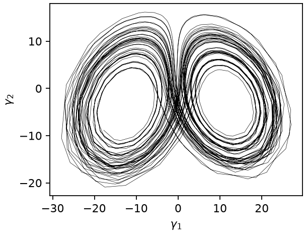

# Phase-space reconstruction

How coordinates for the attractor are obtained — from a scalar record (delay
embedding, with its two free parameters) or from the full state trajectory (MDS).

## Delay embedding (Takens)

The attractor is reconstructed from the scalar record by the delay map

$$
\mathbf{Y}_i = \left( x_i,\ x_{i+\zeta},\ \dots,\ x_{i+(d-1)\zeta} \right)
\in \mathbb{R}^d ,
$$

which is an embedding (diffeomorphic to the true attractor) for
$d > 2\,d_A$ with $d_A$ the attractor's box-counting dimension [Takens 1981].
`delay_embed(x, dim, lag)` builds $\mathbf{Y}$; the two free parameters are
chosen as follows.

*Two delay coordinates of chaotic Lorenz63 ($\zeta = 8$ samples).*

## Optimal lag: average mutual information

The AMI between the signal and its $\zeta$-shifted copy,

$$
I(\zeta) = \sum_{k,l} p_{kl}(\zeta)\,
\ln \frac{p_{kl}(\zeta)}{p_k\, p_l},
$$

is estimated on a histogram ($p_k$: marginal bin probabilities, $p_{kl}$:
joint probabilities of $x_i$ falling in bin $k$ and $x_{i+\zeta}$ in bin $l$).
`optimal_lag` returns the **first local minimum** of $I(\zeta)$ — the classic
compromise between independence (large $I$ drop) and staying on the same
attractor fold [Fraser & Swinney 1986].

*AMI of the Lorenz63 $x$ record; the first local minimum sets $\zeta = 8$.*

## Embedding dimension: false nearest neighbours

For each point $\mathbf{Y}_i$ in dimension $d$ with nearest neighbour
$\mathbf{Y}_{n(i)}$ at distance $R_d(i)$, the neighbour is declared **false** if
unfolding to $d+1$ stretches it too much [Kennel et al. 1992]:

$$
\frac{\left| x_{i+d\zeta} - x_{n(i)+d\zeta} \right|}{R_d(i)} > R_\mathrm{tol}
\quad \text{or} \quad
\frac{R_{d+1}(i)}{\sigma_x} > A_\mathrm{tol},
$$

with $R_\mathrm{tol} = 10$, $A_\mathrm{tol} = 2$ and $\sigma_x$ the signal's
standard deviation. `false_nearest_neighbours` returns the smallest $d$ whose
false-neighbour fraction drops below 1%.

*False-neighbour fraction for Lorenz63: below the 1% threshold (dashed) at $d = 3$.*

## Embedding dimension: Cao's method

Cao (1997) replaces the distance threshold of false nearest neighbours by a ratio
of averages. With $n(i,d)$ the nearest neighbour of $\mathbf{Y}_i$ in dimension
$d$ (maximum norm, outside the Theiler window $\lvert i - n \rvert \le w$),

$$
a(i, d) = \frac{\lVert \mathbf{Y}_i^{(d+1)} - \mathbf{Y}_{n(i,d)}^{(d+1)} \rVert_\infty}
               {\lVert \mathbf{Y}_i^{(d)} - \mathbf{Y}_{n(i,d)}^{(d)} \rVert_\infty},
\qquad
E_1(d) = \frac{\langle a(i, d+1) \rangle_i}{\langle a(i, d) \rangle_i},
$$

where the superscript is the embedding dimension. $E_1(d)$ stops changing once
$d$ unfolds the attractor; `cao_embedding_dimension` returns the first $d$ at
which successive values of $E_1$ differ by less than `tol`. Because $E_1$ also
saturates for random data, the second quantity

$$
E_2(d) = \frac{E^*(d+1)}{E^*(d)}, \qquad
E^*(d) = \langle \lvert x_{i+d\zeta} - x_{n(i,d)+d\zeta} \rvert \rangle_i ,
$$

separates the two cases: $E_2(d) \approx 1$ for every $d$ when the series is
stochastic, whereas a deterministic series has $E_2(d) \ne 1$ at small $d$. On
high-dimensional chaos with a long delay, $E_2$ approaches 1 as well, so a
flat $E_2$ is a necessary, not a sufficient, sign of noise.

## Embedding dimension: Takens' bound

Takens' theorem guarantees an embedding for every $d \ge 2D + 1$, so the
minimum embedding dimension $m_\mathrm{min}$, which Cao's method and false
nearest neighbours estimate, satisfies

$$
D < m_\mathrm{min} \le \lfloor 2D + 1 \rfloor ,
$$

where the lower bound holds because the reconstruction must contain the
attractor. In Takens (1981), $D$ is the dimension of the manifold that contains
the dynamics (Lorenz-63: $D = 3$, bound 7); in Sauer, Yorke & Casdagli (1991),
$D$ is the box-counting dimension of the attractor (Lorenz-63: $D \approx 2.06$,
bound 5). `takens_bound` returns the bound for a given $D$, or estimates $D$ as
the correlation dimension $D_2$ of the delay embedding when it receives the
series. The bound is a sufficient condition, so it typically exceeds the
minimum dimension found from the data.

*Columns: Lorenz-63 $x$, Lorenz-96 $x_1$ ($N_x = 10$, $F = 8$) and white noise.
Rows: $E_1$, $E_2$, the false-neighbour fraction and $D_2$ of the delay
embedding against $d$. Dashed and dash-dotted lines mark the Cao and FNN
estimates; grey shading marks $d \le D$ and green shading $d > \lfloor 2D+1 \rfloor$,
with $D = D_\mathrm{KY}$ for the Lorenz systems and $D_2$ for noise. The
comparison, including the dependence on series length and observation noise, is
in the [embedding-dimension tutorial](../tutorials/tutorial_embedding_dimension.html).*

## Classical multidimensional scaling

From the pairwise distance matrix $D_{ij}$ of the (subsampled) state
trajectory, the Gram matrix is recovered by double centring,

$$
B = -\tfrac{1}{2}\, H\, D^{(2)}\, H, \qquad
H = I - \tfrac{1}{n}\mathbf{1}\mathbf{1}^{\!\top},
$$

where $D^{(2)}$ holds squared distances. The embedding coordinates are
$\gamma_j = \sqrt{\mu_j}\, v_j$ from the top eigenpairs $(\mu_j, v_j)$ of $B$
— a distance-preserving 3-D view of the attractor that requires no choice of
observable.

*First two MDS coordinates $\gamma_1, \gamma_2$ of the Lorenz63 state trajectory.*

References are collected on the [theory overview](../theory.md).
